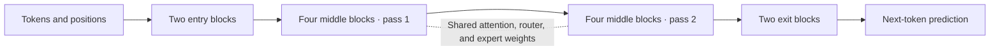
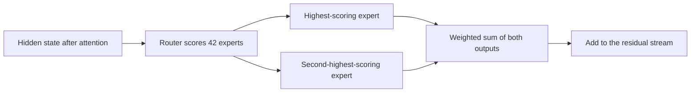

# Looped MoE with diagrams and code

[日本語版](README.md)

This guide walks through the architecture used in a small language model experiment. It combines a **Looped Transformer**, which runs the middle blocks repeatedly, with a **Mixture of Experts (MoE)**, which routes each token to selected feed-forward networks.

## 1. Run the same four blocks twice

Tokens pass through two entry blocks, two passes through the middle four blocks, and two exit blocks before the model predicts the next token. The second pass takes the hidden state produced by the first.



The execution order is `0, 1, (2, 3, 4, 5), (2, 3, 4, 5), 6, 7`. Both passes call the same middle-block modules. The model stores **eight independently parameterized blocks** and executes **twelve block calls** per forward pass. During backpropagation, gradients from both passes accumulate in the shared parameters.

## 2. Route each token to two experts

Each block starts with causal self-attention, which gathers information from earlier tokens. The router then scores all 42 experts using the token's updated hidden state and selects the two highest-scoring experts. Each expert is a SwiGLU feed-forward network.



A softmax over the two selected scores sets the weights in the sum. The hidden state changes between passes, so a shared router can select different experts on the second pass. Training adds a load-balancing loss to discourage routing too many tokens to a few experts.

## 3. The trained model

| Property | Setting |
|---|---|
| Blocks | 8 independently parameterized blocks, 12 calls |
| Hidden width and attention | 512, with 8 attention heads |
| Experts | 42 per block, top-2 routing, SwiGLU intermediate width of 2,944 |
| Positions and context | Learned absolute position embeddings, 512 tokens |
| Vocabulary | 16,384 tokens, with tied input embeddings and output weights |
| Stored parameters | **1,536,606,720** |
| Active parameter uses per token | **130,032,128**, counting each use of a shared weight |

A 12-block version with the same dimensions and independent weights stores about 2.30B parameters. Sharing the middle blocks reduces that count by about 33%. The looped version still executes twelve block calls per forward pass, so the parameter reduction alone does not predict inference speed.

The model was pretrained on about 3B tokens with a 1:8 Japanese-to-English ratio, then fine-tuned on Japanese Magpie conversations with loss applied to assistant responses. The final validation loss was 2.690 for pretraining and 2.004 for supervised fine-tuning. Each stage used its own validation set. [Magpie SFT v1.0](https://huggingface.co/datasets/llm-jp/magpie-sft-v1.0)

## Try it on a CPU

```bash
python -m pip install -r requirements.txt
python walkthrough.py
```

The demo initializes a small model with random weights and prints the block execution order, the experts selected for the first token on each visit to a shared block, and the gradient norm of that block's expert weights after backpropagation.

- In [moe.py](moe.py), start with `MoEConfig.block_order`, then read `MoELanguageModel.forward` and `ExpertLayer.forward`.
- [walkthrough.py](walkthrough.py) uses the same implementation to show what happens during one forward and backward pass.

## References

- [Reasoning with Latent Thoughts: On the Power of Looped Transformers](https://proceedings.iclr.cc/paper_files/paper/2025/file/2676109d49d1eb26d6bc584a8f556305-Paper-Conference.pdf)
- [OLMoE: Open Mixture-of-Experts Language Models](https://arxiv.org/abs/2409.02060)
